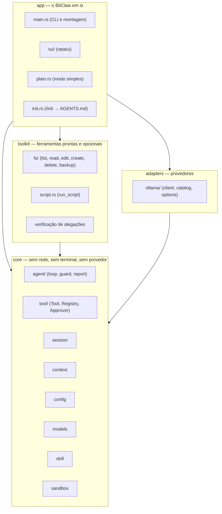
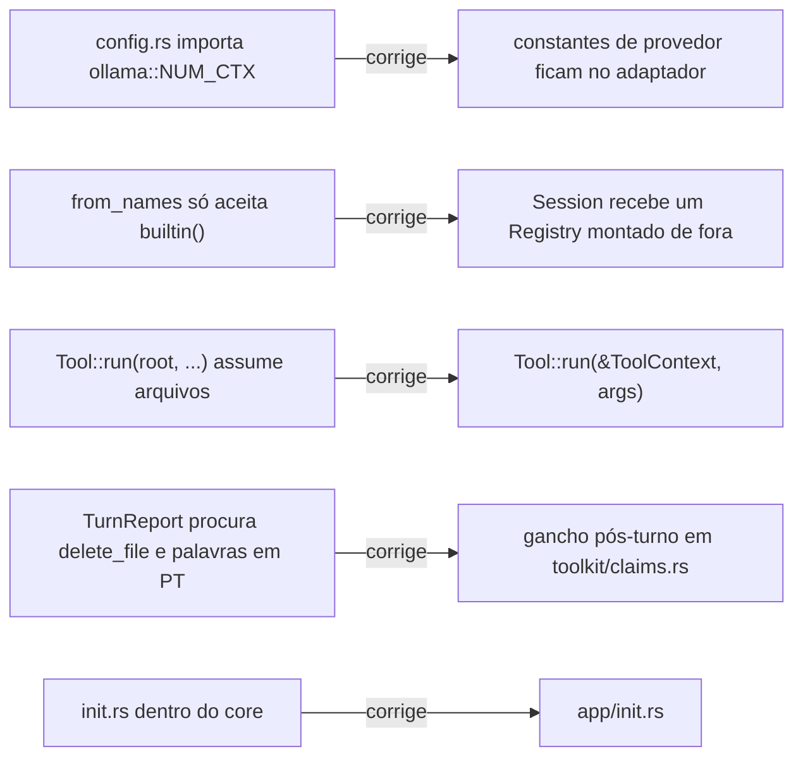
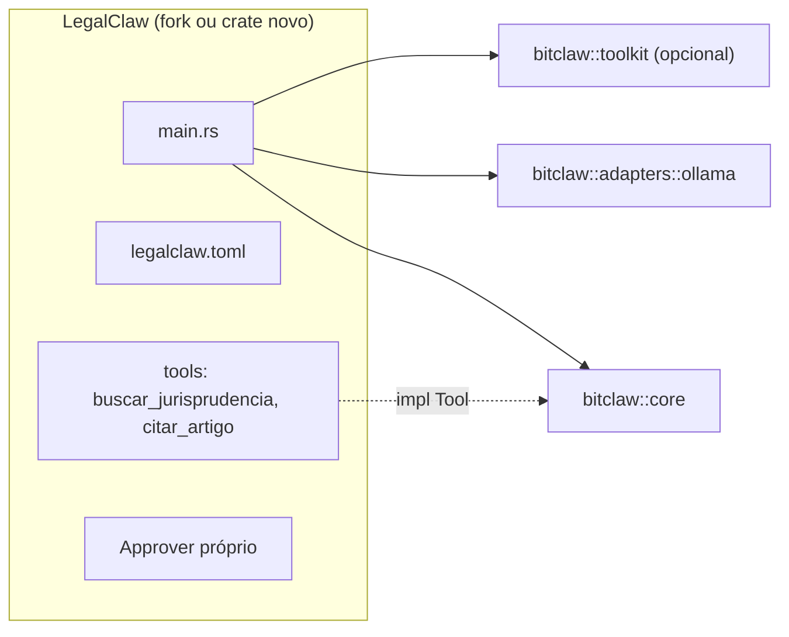
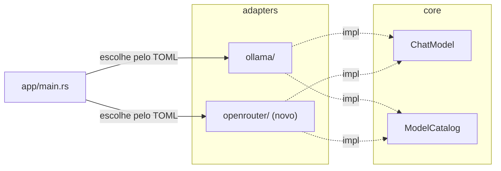

# BitClaw — arquitetura e plano de refatoração

Este documento descreve a arquitetura alvo do `src/` e o plano para chegar lá. A refatoração **reorganiza e separa responsabilidades; não remove nada**: a TUI, o modo simples, as ferramentas de arquivo, `run_script`, skills, `/init`, o adaptador do Ollama e todos os comandos continuam existindo.

## 1. Princípio

> O core não conhece ninguém. Quem conhece o core são os adaptadores, o toolkit e o app.

Não adotamos hexagonal nem clean architecture como doutrina. Ficamos só com a regra de dependência, que o projeto já pratica de forma informal (`ChatModel`, `Tool`, `Approver`, `Progress`), e a tornamos explícita e verificável.

Critério de sucesso (de `docs/PROJETO.md`): alguém constrói um agente novo (LegalClaw, DevClaw…) usando só a API pública do core, sem editá-lo.

## 2. Camadas



Regra: setas só apontam para baixo. `core` nunca importa `adapters`, `toolkit` nem `app`.

## 3. Estrutura de pastas alvo

```text
src/
  lib.rs                  fachada pública: reexporta core, adapters e toolkit
  main.rs                 só CLI e montagem

  core/
    mod.rs
    agent/
      mod.rs              reexporta
      model.rs            ChatModel, Reply, Chunk
      turn.rs             run_turn / run_turn_with (o loop)
      guard.rs            LoopGuard, is_looping
      text_calls.rs       chamadas de ferramenta escritas como texto
      report.rs           Action, TurnReport, Progress, Silent
      tests.rs
    tool/
      mod.rs              Tool, Outcome, ToolContext
      registry.rs         Registry (aceita ferramentas de qualquer origem)
      approval.rs         Approver, AutoApprover, Preview, PreviewLine
    session.rs
    context.rs
    config.rs
    models.rs
    skill.rs
    sandbox.rs

  adapters/
    mod.rs
    ollama/
      mod.rs
      client.rs
      catalog.rs
      options.rs          NUM_CTX, TEMPERATURE, SharedOptions

  toolkit/
    mod.rs                builtin_catalog(): nome → ferramenta
    fs/
      mod.rs
      list_dir.rs  read_file.rs  edit_file.rs
      create_file.rs  create_dir.rs  delete_file.rs
      backup.rs  preview.rs
    script.rs             run_script
    claims.rs             "diz que criou, mas nada mudou"

  app/
    mod.rs
    init.rs               /init
    tui/                  tudo o que já existe em src/tui
    plain.rs
```

### Para onde vai cada arquivo atual

| Hoje | Depois |
|---|---|
| `agent.rs` | `core/agent/{model,turn,guard,text_calls,report}.rs` |
| `tools.rs` (contrato, registro, `Approver`) | `core/tool/` |
| `tools.rs` (6 ferramentas, backup, prévia) | `toolkit/fs/` |
| `script.rs` | `toolkit/script.rs` |
| `skills.rs` | `core/skill.rs` |
| `ollama.rs` | `adapters/ollama/` |
| `init.rs` | `app/init.rs` |
| `tui/`, `tui/plain.rs` | `app/tui/`, `app/plain.rs` |
| `session.rs`, `context.rs`, `config.rs`, `models.rs`, `sandbox.rs` | `core/` |

## 4. Vazamentos a corrigir

Cada item foi verificado no código atual.



1. **Config e provedor.** O core mantém `name`, `context_window` e limites. `url` e `temperature` passam para uma seção do adaptador (`[ollama]`). O TOML antigo continua sendo lido durante a transição, com aviso.
2. **Registro injetável.** Hoje um fork não consegue registrar a própria `Tool`, porque `Session::from_config` só resolve nomes do `match` de `builtin()`. Passa a ser:

   ```rust
   let session = Session::builder(&cfg)
       .model(model)
       .approver(approver)
       .tools(registry)   // toolkit::fs() + as ferramentas do fork
       .root(path)
       .build()?;
   ```

   `toolkit::builtin_catalog()` resolve os nomes do TOML; o fork soma as suas.
3. **Contrato neutro.** `ToolContext { root, approver }` no lugar de `root` solto (uma ferramenta que consulta um banco não precisa de pasta). O `schema()` passa a ser neutro (nome, descrição, parâmetros); o adaptador do Ollama o embrulha em `{"type": "function", ...}`.
4. **Política de arquivo fora do core.** `mutates`, `deleted()` e as listas `CHANGE_WORDS`/`DELETE_WORDS` migram para `toolkit/claims.rs`, ligadas ao turno por um gancho. O comportamento de aviso ao usuário permanece idêntico.
5. **`/init`** sai do core. `Session::init_agents` é substituído por `app::init::write(root, approver)`; o comando `/init` continua igual para o usuário.

## 5. Como um fork usa o core



Para trocar de provedor, o fork implementa `ChatModel` e `ModelCatalog`. Para trocar de interface, implementa `Approver` e `Progress` (ou reaproveita `app::tui`).

## 5.1 Exemplo: adicionar o OpenRouter (com chave de API)

O OpenRouter entra como um novo adaptador ao lado do Ollama. O core não muda, porque `ChatModel` e `ModelCatalog` já bastam.

```text
adapters/
  ollama/
  openrouter/
    mod.rs
    client.rs     implementa ChatModel (POST /chat/completions, streaming SSE)
    catalog.rs    implementa ModelCatalog (GET /models)
    auth.rs       lê a chave de OPENROUTER_API_KEY
```



O OpenRouter fala o formato OpenAI (`/chat/completions`) e o Ollama fala `/api/chat`. Cada adaptador traduz o formato neutro do core para o seu. Por isso o schema de ferramenta neutro (passo 4) é pré-requisito: hoje o `schema()` já sai no formato do Ollama.

Dados do provedor ficam em seção própria:

```toml
[model]
provider = "openrouter"        # "ollama" | "openrouter"
name = "anthropic/claude-sonnet-4"
context_window = 200000

[openrouter]
base_url = "https://openrouter.ai/api/v1"
api_key_env = "OPENROUTER_API_KEY"   # o TOML guarda o nome da variável, nunca a chave
temperature = 0.1
```

**A chave nunca vai no TOML**, que é versionado e lido pelo `/init`. O adaptador lê a variável de ambiente ao montar o cliente. Se ela não existir, o erro diz qual variável falta. A chave não pode aparecer em mensagens de erro, em `/status` nem em logs.

| Camada | Mudança |
|---|---|
| `core` | Nenhuma. |
| `adapters/openrouter` | Novo: cliente, catálogo e leitura da chave. |
| `app/main.rs` | Um `match cfg.model.provider` que monta o adaptador certo. É a única seleção de provedor do projeto. |
| TOML | `provider` e a seção `[openrouter]`. |
| TUI | Quase nada, desde que deixe de importar `ollama::SharedOptions` e use um tipo neutro de opções. |

Pontos de atenção:

- **Raciocínio:** o catálogo preenche `ModelCapabilities` a partir de `GET /models`; se faltar o campo, usa `ModelCapabilities::unknown()`.
- **Contexto:** a janela vem de `context_length` por modelo, e a calibração do `ContextManager` usa `usage.prompt_tokens` no lugar de `prompt_eval_count`.
- **Privacidade:** o conteúdo dos arquivos do projeto sai da máquina. Avisar na inicialização quando o provedor for remoto e documentar no README (Segurança).
- **Erros:** converter 401, 402 e 429 em `Err(String)` legível, sem ecoar cabeçalhos com a chave.

## 6. Convenções (humano e IA)

- Um arquivo, uma responsabilidade, aberto por uma frase em `//!` (o `/init` já usa isso para montar o `AGENTS.md`).
- Meta de cerca de 300 linhas de código por arquivo; `mod.rs` só reexporta.
- Testes em `tests.rs` ao lado do módulo, não inline em arquivos grandes.
- Dependência só para baixo (seção 2). Um teste falha se `core/` contiver `use crate::adapters`, `crate::toolkit` ou `crate::app`.
- Toda funcionalidade nova tem teste que não depende de rede nem de modelo real.
- Dívida anotada, fora do escopo: mensagens de erro do core estão em português; um fork em outro idioma sentirá isso.

## 7. Plano de execução

Cada passo é um commit pequeno, com `cargo test` verde e comportamento inalterado para o usuário.

| # | Passo | Resultado |
|---|---|---|
| 1 | Criar `core/`, `adapters/`, `toolkit/`, `app/` e mover arquivos (seção 3), mantendo reexports em `lib.rs` | Mesmos caminhos públicos funcionando |
| 2 | Dividir `agent.rs` e `tools.rs`; mover testes para `tests.rs` | Arquivos pequenos e focados |
| 3 | Constantes de provedor para o adaptador; seção `[ollama]` no TOML (com compatibilidade) | Core sem import de `ollama` |
| 4 | `Registry` injetável, `Session::builder`, `ToolContext`, schema neutro | Fork adiciona `Tool` sem editar o core |
| 5 | `toolkit/claims.rs` como gancho; `init` para `app/` | Core sem política de arquivo nem de dev |
| 6 | Teste de fronteira e `examples/legalclaw.rs` com uma `Tool` própria | Critério de sucesso provado |
| 7 | Adaptador `adapters/openrouter/` com chave via variável de ambiente (seção 5.1); depende dos passos 3 e 4 | Segundo provedor sem tocar no core |

## 8. O que não muda

TUI completa, modo simples, `/model`, `/context`, `/temp`, `/status`, `/init`, as sete ferramentas (incluindo `run_script` com aprovação sempre), skills, backup em `.bitclaw/backup`, sandbox de caminhos, gerenciador de contexto, `agents/bitclaw.toml` e `scripts/eval.sh`. Os 222 testes atuais são a rede de segurança: nenhum passo é aceito com teste quebrado.
