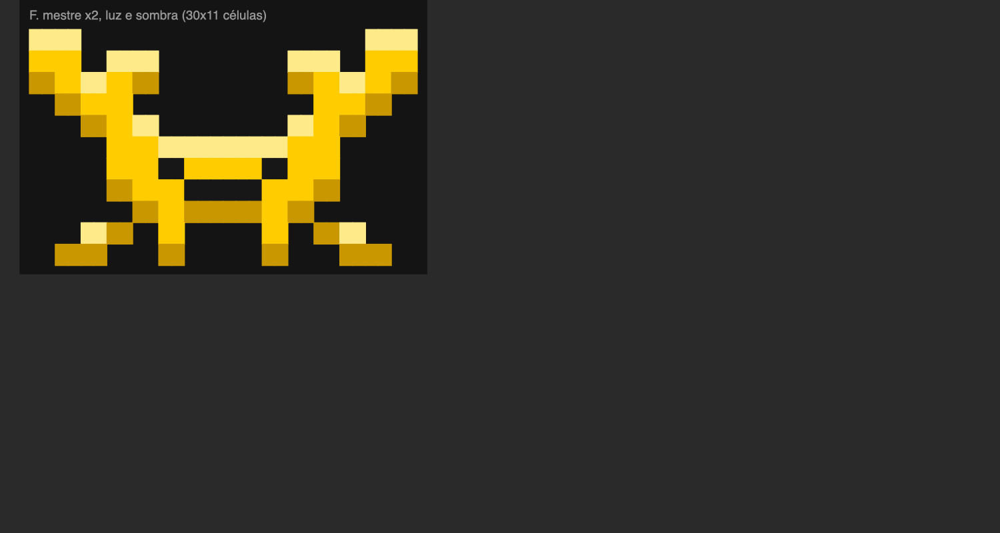
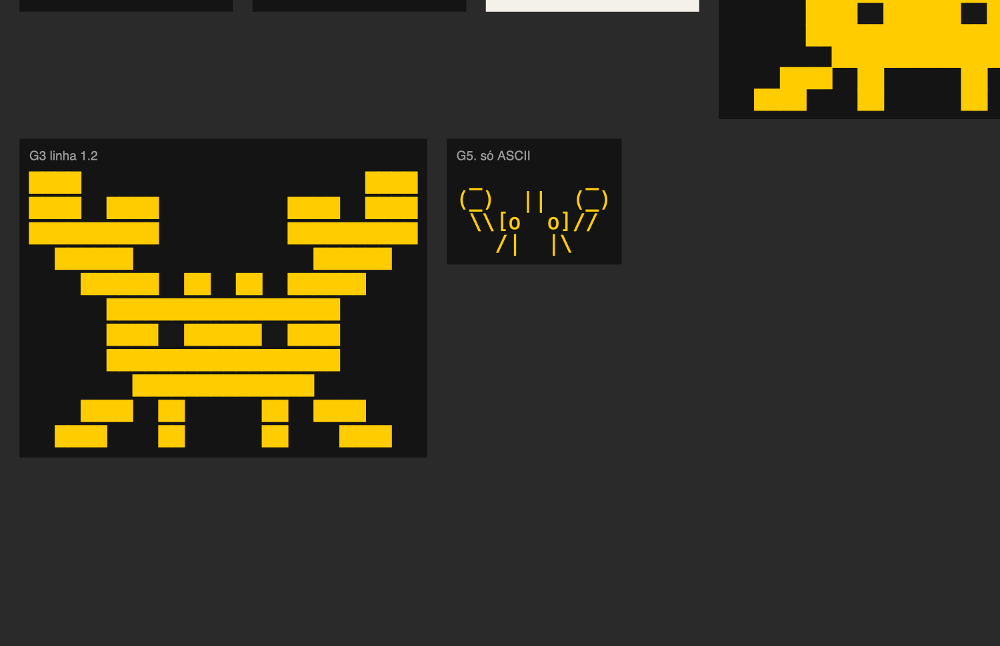
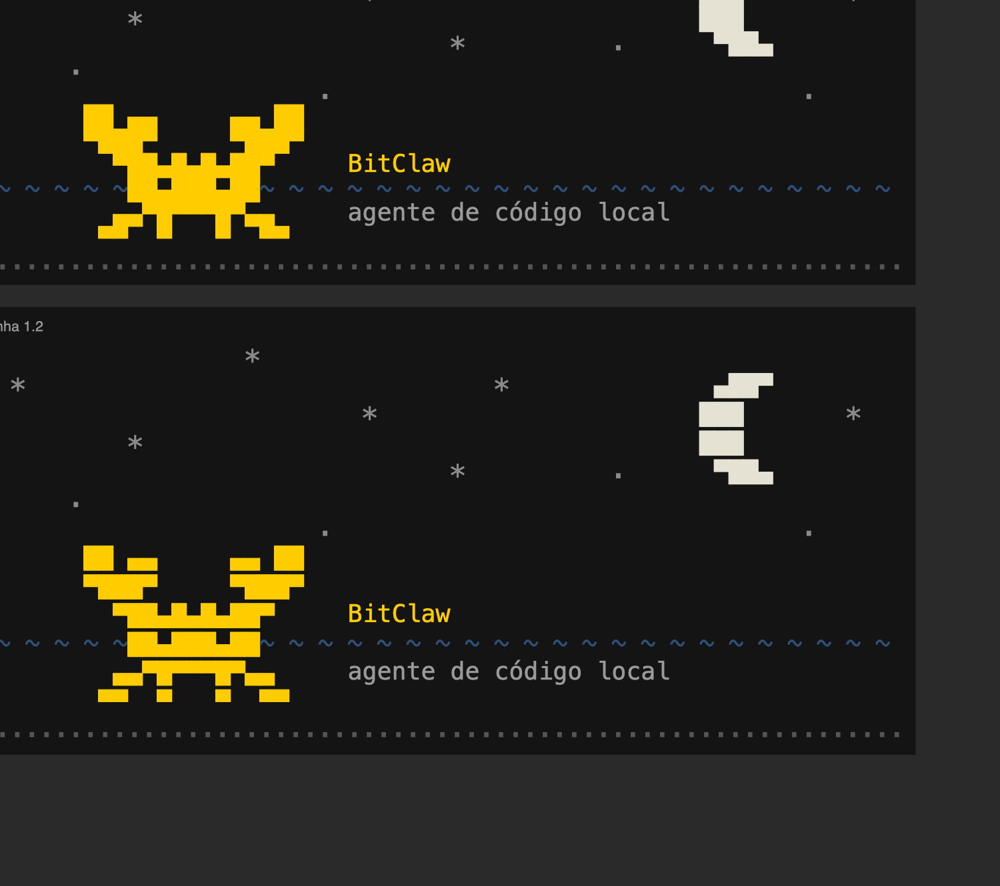

# Arte para o terminal: estudo e decisões

Estudo feito antes de desenhar o mascote grande e a tela de boas-vindas. As imagens vêm de uma
pré-visualização que imita um terminal: HTML com Menlo (a fonte padrão do Terminal do macOS), célula 1:2,
renderizado pelo WebKit com `qlmanage -t`. Isso mostra o que os caracteres viram na fonte, mas não
substitui ver no terminal de verdade.

## 1. Técnicas comparadas

| Técnica | Pixels por célula | Resultado |
|---|---|---|
| Meios-blocos `▀ ▄ █` | 1 × 2 | Pixel quadrado, porque a célula tem 1:2. É o que o BitClaw já usa. |
| Meios-blocos com cor de fundo | 1 × 2, duas cores | Dá duas cores por célula, mas a emenda entre `▀` e o fundo deixa riscos finos em algumas fontes. |
| Quadrantes `▖ ▗ ▘ ▝` | 2 × 2 | Funcionam no Menlo. Ficam pequenos demais para um mascote de 15 pixels. |
| Sextantes `🬀 🬁 🬂` | 2 × 3 | **Não existem no Menlo** (viram quadradinho vazio). Descartados. |
| Braille `⣿ ⡇` | 2 × 4 | Funciona, mas é pontilhado e de uma cor só. Serve para gráfico, não para personagem. |
| Protocolo gráfico (iTerm2, Kitty) | imagem | Já usado no cabeçalho (`brand::Graphics`). Só em terminais que o suportam. |

## 2. O que o estudo mostrou

1. **Luz e sombra por pixel atrapalham.** Em 15 × 11 pixels, o sombreado vira listras e esconde a
   silhueta (C e F na imagem acima). A profundidade da identidade vem dos pinos e do contorno das peças,
   não de gradiente. No terminal, o mascote fica numa cor só.
2. **Espaçamento de linha maior que 1,0 abre faixas.** Com meios-blocos na escala 1, a faixa aparece a
   cada dois pixels, de forma irregular (D). Na escala 2 cada pixel ocupa uma célula inteira de altura, e a
   faixa cai só entre pixels: o mascote vira **tijolos empilhados**, o que combina com "um caranguejo feito
   de peças".
3. **Olho como buraco é mais robusto que olho pintado.** Olho pintado exige cor de fundo na célula
   (riscos na emenda, ver 1). O buraco deixa o fundo do terminal aparecer, em qualquer tema.
4. **Os dois pinos no topo do corpo são a assinatura.** Sem eles é "um caranguejo"; com eles é o BitClaw.
5. **Amarelo `#FFCC00` em fundo claro tem pouco contraste.** Um tema claro precisa de âmbar mais escuro
   (`#D9A400` funcionou na prévia).
6. **Só ASCII não carrega a marca.** Fica legível, mas sem a silhueta. Não entra no código.

## 3. Cena da boas-vindas

Céu com estrelas (`*` e `.`, ASCII, sem largura ambígua), lua crescente em meios-blocos, horizonte de mar
(`~`) atrás do caranguejo e chão pontilhado. O mar passa por trás do mascote e aparece entre as patas, o
que dá profundidade sem cor de fundo. O texto fica abaixo da cena, não dentro dela: dentro, ele cruza a
linha do mar.

## 4. Regras que valem para qualquer arte nova

- Só caracteres de largura 1: ASCII e blocos `U+2580–U+259F`. Nada de emoji nem sextantes.
- Uma cor por objeto, sem cor de fundo. O fundo é sempre o do terminal.
- A grade é a fonte: cada desenho mora num SVG de retângulos em `assets/` e o código o lê, como já faz
  com `bitclaw-crab.svg`.
- Abaixo do tamanho que cabe, a arte some inteira; nunca aparece cortada.
- `--no-color` e `NO_COLOR` desligam as cores, e a arte continua legível pela forma.
