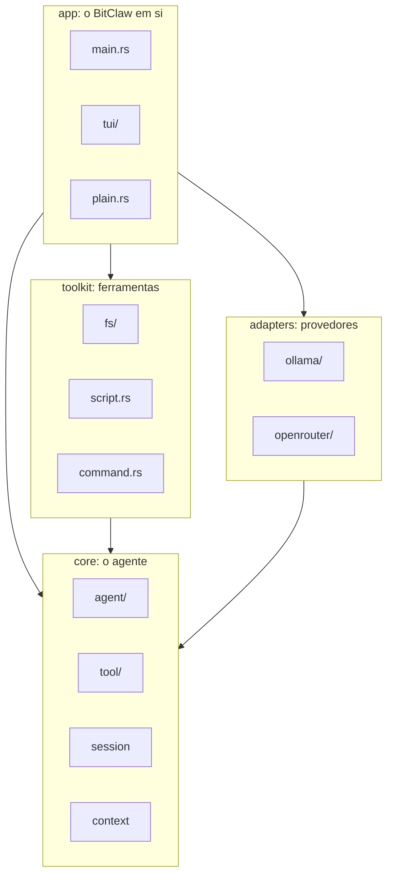

# Arquitetura do código

> O core não conhece ninguém. Quem conhece o core são os adaptadores, o toolkit e o app.

Não é arquitetura hexagonal como doutrina: é só a regra de dependência, tornada explícita e verificável. As setas apontam sempre para baixo; `core` nunca importa `adapters`, `toolkit` nem `app`.

## `src/core/`: o agente

Sem rede, sem terminal e sem provedor.

| Módulo | Papel |
|---|---|
| `agent/turn.rs` | O laço modelo → ferramentas → modelo. |
| `agent/guard.rs` | Detector de laço (repetição de chamadas). |
| `agent/text_calls.rs` | Reconhece chamadas de ferramenta escritas como texto. |
| `agent/hook.rs` | Gancho pós-turno. |
| `agent/model.rs` | O contrato `ChatModel`. |
| `agent/report.rs` | `TurnReport` e `Progress`. |
| `tool/` | O contrato `Tool` com `Annotations`, o `Registry` (inclui `read_only()` para o modo Plan) e o `Approver` com `Preview` tipada. |
| `session.rs` | Sessão de um agente: a API pública do core. |
| `config.rs` | Configuração de um agente, lida de TOML. |
| `context.rs` | Mantém o histórico dentro do orçamento da janela. |
| `skill.rs` | Skills: pastas com `SKILL.md`, carregadas sob demanda por `load_skill`. |
| `sandbox.rs` | Resolve caminhos dentro do projeto (recusa absolutos, `..` e symlinks que saem dele). |
| `models.rs`, `options.rs` | Modelos e capacidades; opções de geração que a interface muda. |

## `src/toolkit/`: ferramentas prontas

| Módulo | Papel |
|---|---|
| `fs/` | `list_dir`, `read_file`, `grep_files`, `find_files`, `edit_file`, `create_file`, `create_dir`, `delete_file`. `backup.rs` guarda o conteúdo anterior; `journal.rs` é o diário do `/undo`. |
| `script.rs` | `run_script`, com aprovação, prazo, saída limitada e ambiente reduzido. `run_process` é a execução comum. |
| `command.rs` | `run_command`: programas conhecidos, sem shell. `classify` põe cada chamada em Leitura, Alteração ou Recusada. |
| `claims.rs` | Confere se o texto final diz que criou, alterou ou removeu algo que as ações não confirmam. |

## `src/adapters/`: provedores de modelo

`ollama/` traduz o núcleo para `/api/chat`; `openrouter/` traduz para `/chat/completions`; `lines.rs` lê respostas em streaming. Adicionar um provedor é escrever um adaptador novo: o core não muda.

## `src/app/`: o BitClaw em si

| Módulo | Papel |
|---|---|
| `provider.rs` | O único lugar que sabe quais adaptadores existem. |
| `skill_install.rs` | `/skill install` (git, prévia, aprovação, lock com digest) e a carga das skills instaladas. |
| `soul.rs` | O SOUL.md, as cinco perguntas e o texto que entra no prompt. |
| `receipts.rs` | `Recorded`, o aprovador que grava os recibos. |
| `init.rs` | `/init`, que cria o `AGENTS.md`. |
| `plain.rs` | O modo simples. |
| `tui/` | A interface de terminal com ratatui: conversa, painéis, comandos, mascote, Markdown, menção `@`, histórico, área de transferência. |

A TUI roda a sessão numa **thread** própria (`worker.rs`) e conversa com ela por canais. O mascote é lido de `assets/bitclaw-crab.svg`, a fonte única da arte: veja [O mascote](../marca/mascote.md).

## Pilha

Rust, edição 2024. Dependências: `crossterm`, `image`, `ratatui`, `ratatui-image`, `ratatui-textarea`, `reqwest`, `resvg`, `serde`, `serde_json`, `sha2` e `toml`.

## Mais fundo

- [Arquitetura alvo](../projeto/arquitetura-alvo.md): o plano de refatoração que levou a esta estrutura.
- [Escolha: histórico](../projeto/escolha-contexto.md): a política de contexto.
- [Documento de projeto](../projeto/documento.md): fases e decisões.
